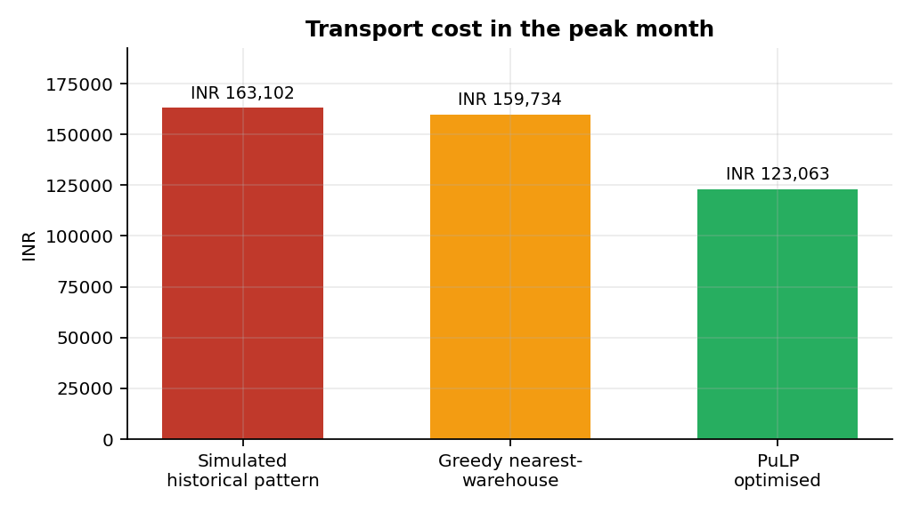
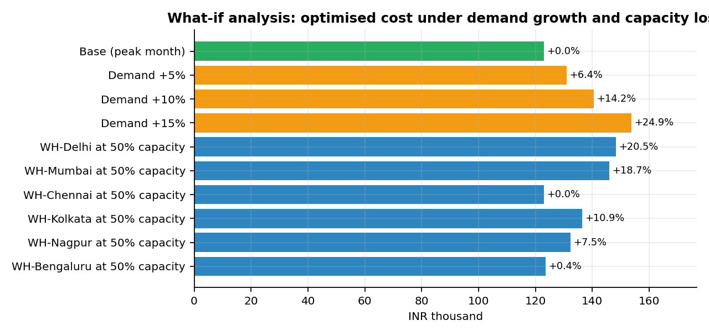
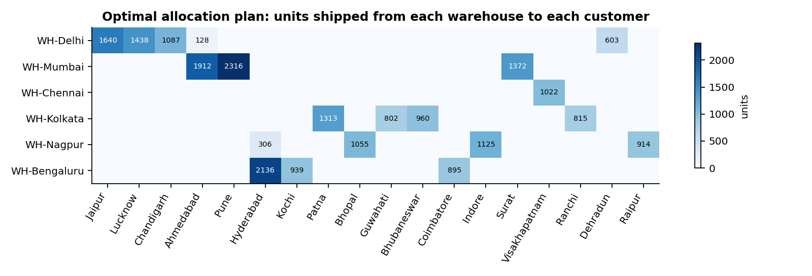
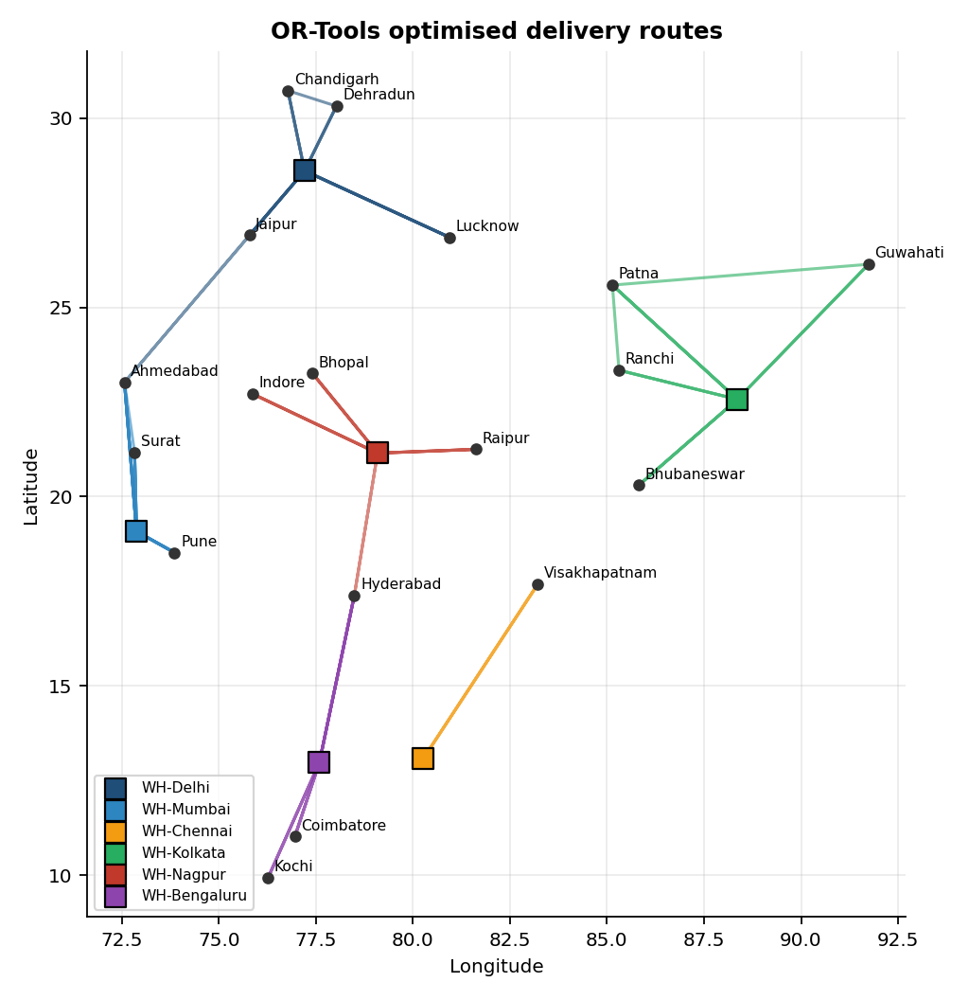
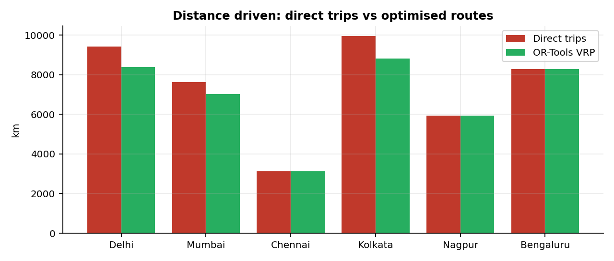
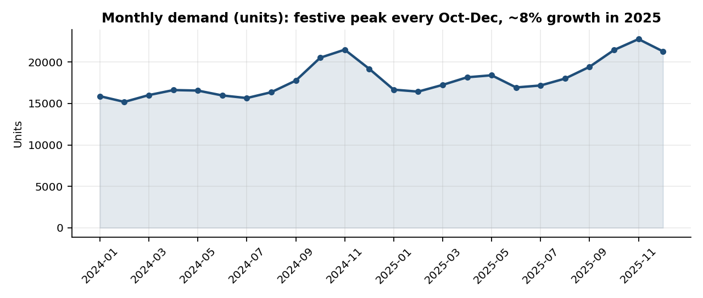
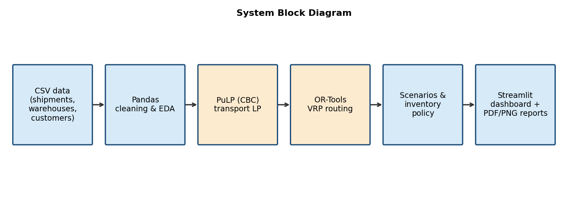

<div align="center">

# 🚚 Supply Chain Analytics & Transportation Optimization System

**Decide which warehouse serves which customer, and how trucks should be routed, at minimum cost.**


-1f4e79)


</div>

> ⚠️ **Data disclaimer:** the dataset is **synthetic** (generated by [`src/generate_data.py`](src/generate_data.py), fixed seed). City coordinates are approximate; demand, costs and delays are simulated. The results show that the *method works*, not real company savings. To use real data, replace the CSVs in `data/` keeping the same columns.

## 📌 Overview
A multi-warehouse distribution company has to answer two questions every month: **which warehouse should ship to which customer**, and **how should trucks be routed**. Doing this by habit (or "nearest warehouse first") wastes money, especially when warehouse capacity is limited in the festive peak.

This project is an end-to-end analyst + operations-research pipeline:

1. **Analyse** 4,363 shipments (2024-01-01 to 2025-12-28) with Pandas: demand trend, cost, delays, product mix.
2. **Optimise allocation** with a PuLP linear programme (min cost, capacity and demand constraints).
3. **Optimise routes** with a Google OR-Tools capacitated vehicle-routing model.
4. **Stress-test** with what-if scenarios (demand growth, warehouse capacity loss).
5. **Recommend inventory** reorder points and safety stock per customer.
6. **Explore everything** in an interactive Streamlit dashboard.

## 📊 Key results (peak month: Nov 2025, 22,778 units)

| Metric | Value |
|---|---|
| Greedy nearest-warehouse baseline | INR 159,734 |
| **PuLP optimised plan** | **INR 123,063** (22.96% lower than baseline) |
| Simulated historical pattern | INR 163,102 (optimised is 24.55% lower) |
| Distance: direct trips → OR-Tools routes | 44,379 km → 41,566 km (6.34% less) |
| Delay rate: Standard vs Express orders | 9.4% vs 32.6% |

**How to read these numbers:** the size of the saving depends on how tight warehouse capacity is and on how weak the baseline is. Here capacity is ~84% utilised at peak, which makes the simple greedy rule noticeably worse than the optimum. With loose capacity the gap would be small. The "historical" comparison is flattering because the simulated history ships about 40% of orders from farther warehouses by design, so treat the greedy comparison as the more conservative one.

**What-if analysis** (optimised cost in the peak month):

| Scenario | Optimised cost |
|---|---|
| Base | INR 123,063 (+0.0%) |
| Demand +10% | INR 140,476 (+14.2%) |
| Demand +15% | INR 153,744 (+24.9%) |
| Delhi warehouse at 50% capacity | INR 148,285 (+20.5%) |
| Mumbai warehouse at 50% capacity | INR 146,022 (+18.7%) |

<p align="center"> </p>

## 🖼️ Visuals
<p align="center"></p>
<p align="center"> </p>
<p align="center"></p>

## 🏗️ Architecture
<p align="center"></p>

## 🧠 Method
**1. Transportation LP (PuLP + CBC).** For warehouses *i* and customers *j*, with road distance *d<sub>ij</sub>* and cost rate *r*:

```
minimise   Σ  r · d_ij · x_ij
subject to Σ_j x_ij ≤ capacity_i        (each warehouse)
           Σ_i x_ij  = demand_j         (each customer fully served)
           x_ij ≥ 0
```

**2. Baseline.** Customers (largest first) are served from the nearest warehouse that still has stock.

**3. Routing (OR-Tools CVRP).** For each warehouse, the customers it serves in the LP plan are routed with trucks of 600 units, minimising kilometres (guided local search). Customers needing more than one truck are split into full-truckload visits. Compared with one direct round trip per truckload.

**4. Inventory policy.** Reorder point = mean lead-time demand + safety stock, where safety stock = 1.65 · σ<sub>daily</sub> · √lead time (about 95% service level).

**Assumptions:** road distance = 1.3 × straight-line; cost = INR 0.012 per unit-km (the same rate used in the shipment history); truck cost INR 28/km; lead time = distance / 450 km per day + 1 day.

## 🚀 Quick start
```bash
git clone https://github.com/<your-username>/supply-chain-optimization.git
cd supply-chain-optimization
pip install -r requirements.txt

python main.py            # regenerate data, solve models, save charts + CSVs to outputs/
streamlit run app.py      # open the interactive dashboard
python src/make_report.py # optional: build the PDF report
```
Deploy free on [Streamlit Community Cloud](https://streamlit.io/cloud): push this repo to GitHub, choose *New app*, select the repo, and set the main file to `app.py`.

## 🗂️ Project structure
```
├── app.py                  # Streamlit dashboard
├── main.py                 # one-command pipeline
├── src/
│   ├── generate_data.py    # synthetic dataset generator
│   ├── optimize.py         # PuLP LP, greedy baseline, OR-Tools VRP, scenarios, inventory
│   ├── analytics.py        # EDA + chart generation
│   └── make_report.py      # PDF synopsis builder
├── data/                   # shipments, warehouses, customers, distance matrix (CSV)
├── notebooks/analysis.ipynb
├── outputs/                # results.json, allocation / routing / scenario / inventory CSVs, charts/
└── requirements.txt
```

## 🗃️ Data dictionary (`data/shipments.csv`, 4,363 rows)
| Column | Meaning |
|---|---|
| order_id, order_date | Order identifier and date |
| warehouse, customer | Origin and destination (6 warehouses, 18 customers) |
| product_category | FMCG, Electronics or Apparel |
| priority | Standard or Express |
| quantity, vehicle_type | Units shipped; Small / Medium / Heavy by size |
| distance_km | Road distance (1.3 × great-circle) |
| transport_cost | INR, per unit-km plus a fixed charge |
| promised_days, delivery_days, delayed | Service-level fields (delayed = 1 if late) |

## ⚠️ Limitations
- Synthetic data; real demand is noisier and warehouse stock levels change daily.
- Single-period, single-product transportation model; no time windows, driver hours or multi-stop road networks (distances are straight-line × 1.3, not live road distances).
- Routing is solved per warehouse with a short time limit, so routes are good, not guaranteed optimal.

## 🔮 Future work
Multi-period inventory planning, real road distances (OSRM / Google Maps API), demand forecasting (ARIMA / Prophet) feeding the optimiser, CO₂ cost per route, and time-window constraints.

## 🛠️ Tech stack
Python · Pandas · NumPy · PuLP (CBC) · Google OR-Tools · Matplotlib · Plotly · Streamlit · ReportLab

## 👤 Author
**Suraj** · ABES Engineering College, Ghaziabad · [LinkedIn](https://www.linkedin.com/in/suraj17singh/)


*AI disclosure: this project was built with the help of an AI assistant (Claude by Anthropic) and reviewed by the author.*
